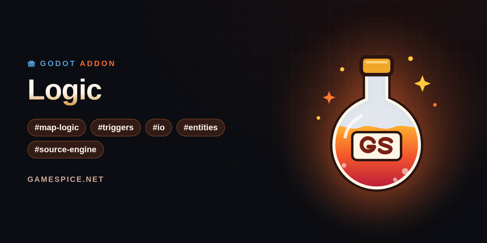

[](https://moddingcommunity.com/a/146-gs-logic)

Map-side logic as data, for Godot 4.7+. Named entities have inputs and outputs, and a list of connections says *when this entity's output fires, send that input to that entity, after a delay*. Relays, counters, timers, auto entities, branches, compares and cases are built in, and anything else is a `node` that hands the input back to your game. Part of the [GameSpice](https://github.com/gamespice-platform) family. It needs only [GameSpice Core](https://github.com/gamespice-platform/core).

The Source engine's way of wiring a map (names, inputs, outputs, delays) is small, readable and what converted maps already carry. This addon is that model with no engine entities, no scenes and no clock of its own: you feed it time, and it tells you what to do.

## Install

1. Copy `addons/dot_logic/` and `addons/dot_core/` into your project.
2. Enable GameSpice Logic in *Project > Project Settings > Plugins*.

## Quick start

```gdscript
var g := DotLogicGraph.new()
g.config = cfg                                     # a DotLogicConfig
var r := g.load_document({
    "entities": [
        {"name": "boot", "class": "auto"},
        {"name": "relay", "class": "relay", "once": true},
        {"name": "door", "class": "node"},         # your game acts on it
    ],
    "connections": [
        {"from": "boot", "output": "OnSpawn", "to": "relay", "input": "Trigger"},
        {"from": "relay", "output": "OnTrigger", "to": "door", "input": "Open", "delay": 1.5},
    ]})
if not r.ok:
    push_error(r.error.message)                    # every problem is listed

g.node_input.connect(func(entity: String, input: String, param: String, activator: Variant) -> void:
    world.get_door(entity).call(input, param))
g.start()                                          # auto entities fire
g.input("relay", "Trigger", "", 0.0, player)       # from a button, a trigger volume
g.update(delta)                                    # in _physics_process: delayed inputs come due
```

## Entity kinds

| Kind | Inputs | Outputs |
| --- | --- | --- |
| `relay` | Trigger, Enable, Disable, Toggle, CancelPending | OnTrigger (key `once`) |
| `counter` | Add, Subtract, SetValue, Reset, Enable, Disable | OnHitMin, OnHitMax, OutValue (keys `min`, `max`, `start`) |
| `timer` | Enable, Disable, Toggle, ResetTimer | OnTimer (key `interval`) |
| `branch` | SetValue, Test, Enable, Disable | OnTrue, OnFalse |
| `compare` | SetValue, SetCompareValue, Compare | OnLessThan, OnEqualTo, OnGreaterThan (key `compare_value`) |
| `case` | InValue | OnCase<key>, OnDefault (keys `case1`, `case2`, ... hold the text each one matches) |
| `auto` | none | OnSpawn |
| `node` | anything, handed to the game | whatever the game fires with `emit_output()` |

`snapshot()` and `restore()` carry the clock, every entity's state, spent `once` connections and the inputs still waiting, for saves and for handing a map over to a new server. Activators are the game's objects and are not saved.

## Settings

Every number is a field on `DotLogicConfig`. The values below are defaults, and the ranges are inspector slider limits, not enforced caps. Set the property from code or a config file to go beyond them; 0 means unlimited where it says so.

| Setting | Default | What it does |
| --- | --- | --- |
| `enabled` | true | Turns the graph on or off. |
| `max_pending` | 4096 | Delayed inputs that may wait. Past it they are dropped and `overflow` is emitted. 0 is unlimited. |
| `max_chain` | 1000 | Inputs one update may dispatch, which stops a zero-delay loop. 0 is unlimited. |
| `max_entities` | 4096 | Entities in one document. 0 is unlimited. |

Layers, weakest first: the defaults, `cfg/addon/dot_logic/*.yml`, the game's files, the operator's files, `DOT_LOGIC_*` environment variables, then `--logic-*` flags. A game that wants cvars binds the config with GameSpice Game's `DotGameConfigBinder` (`profile_kind = "logic"`).

## What it is not

**Not Source entity classes.** GameSpice Map keeps the converted entities (`DotMapRelay`, `DotMapTrigger`, `DotMapCounter` and the rest of its `io` folder) and loads the map. This addon is the generic, scene-free graph underneath that style, for maps that are not converted.

**Not community scripting.** Rules with conditions, variables and a cost budget, written by a server's community, are GameSpice Script's.

**Not a physics or trigger volume.** Something outside decides a player touched a trigger, then calls `input()`. This addon never looks at the world.

**Not a map editor or a converter.** Building a map is GameSpice Editor's; converting a BSP is GameSpice Map Convert's.

## Test

```bash
godot --headless --path . --import
godot --headless --path . res://examples/logic_selftest.tscn
```

The self-test is offline and exits non-zero on any failure (8 sections, 53 checks plus the two summary checks).

## Status

Built and maintained with Claude Code. The test suites pass, but little of this has been in front of real players yet. Please report rough edges by opening an issue.

## Licence

MIT. See [LICENSE](LICENSE). Only the TMC back-end web infrastructure is not open source.
